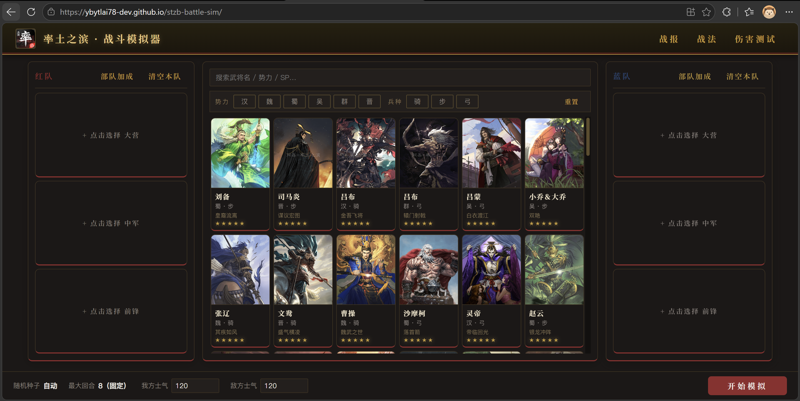
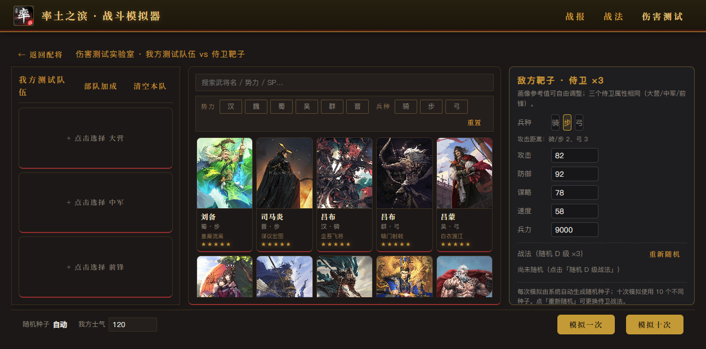

# 率土模拟器

> 《率土之滨》式回合制战斗的网页模拟器：自己配将、跑满 8 回合、逐条核对每一次伤害 —— 同一个种子，永远打出同一场。

**▶ [在线试玩](https://ybytlai78-dev.github.io/stzb-battle-sim/)** 免安装 · 免注册 · 手机浏览器直接开 ｜ **⬇ [安卓安装包](https://github.com/ybytlai78-dev/stzb-battle-sim/releases/latest)** 正式签名 APK



---

## 声明与许可：非官方作品、素材归网易、代码 MIT

> [!IMPORTANT]
> **非官方作品** —— 本项目是玩家自制的非官方技术研究与学习作品，与**网易公司及其关联方**（《率土之滨》的开发与运营方）没有任何关系，未获其授权、认可或赞助；它不是游戏客户端、私服或外挂，不提供任何游戏服务，也不冒充官方客户端。
>
> **素材归网易** —— 《率土之滨》的名称、武将、立绘、标识、战法文案与数值，权利均归网易公司及其关联方所有，**不适用本项目的 MIT 许可证**。本仓库如实包含这些素材（立绘 `public/portraits/`、标识 `public/rate-logo.png`、数据与文案 `web/data/*.json`），它们只服务于本项目的功能演示：请勿单独再分发，也请勿用于训练模型或构建数据集。
>
> **代码 MIT** —— 本项目自己编写的代码（`src/` `web/` `tests/` `scripts/`）采用 [MIT 许可证](LICENSE)，可自由使用、修改、分发。
>
> **禁止任何形式的盈利与商业利用** —— 仅供学习交流与个人非商业使用：禁止售卖本项目或其整合包、付费下载与付费分发，禁止广告、打赏、会员、赞助等任何变现方式。
>
> **侵权即删** —— 权利人如认为本项目侵犯其权益，请通过 [Issue](https://github.com/ybytlai78-dev/stzb-battle-sim/issues) 联系，我们会在收到通知后立即下架相关内容（仓库文件与线上站点一并处理）。
>
> **按「现状」提供** —— 不提供任何担保；所有数值与模拟结果都是研究性还原，不代表官方数据或官方口径，使用风险自负。

完整条款、素材清单与来源登记见 **[NOTICE.md](NOTICE.md)**。

---

## 这是什么

一个**网页版的战斗推演工具**。它把《率土之滨》的回合制战斗规则 —— 出手顺序、战法判定、伤害公式、状态与冲突 —— 还原成一套确定性引擎：配好队伍点一下就开始跑，8 回合给出可以逐条核对的战报。

不用下载、不用注册，打开网页就能用；想装到手机上也有安卓安装包。

| 入口 | 能干什么 |
|------|----------|
| **配将** | 104 名上架武将任选，按势力（汉 / 魏 / 蜀 / 吴 / 群 / 晋）与兵种（骑 / 步 / 弓）筛选，或直接搜名字；红蓝双方各三人排到大营 / 中军 / 前锋，等级、红度、加点、士气都可调 |
| **战报** | 简略看结果、详细看过程、统计看数据：逐回合谁先出手、打了谁、打出多少伤害、兵力怎么掉的 |
| **预设** | 常用阵容存下来，一键上场 |
| **战法** | 386 个战法的类型、攻击距离、发动率、目标与满级文案速查 |
| **伤害测试** | 把对手换成一个参数随便调的靶子（攻击 / 防御 / 谋略 / 速度 / 兵力），专门量「这套战法到底能打多少」 |
| **AI 配将** | 用一句话让它帮你配将、换战法、对拍两套方案；数字全部来自引擎实跑，不由模型自己编 |
| **教程 / 公告** | 新手上手流程，以及每个版本的改动记录 |

**同一场战斗可以复现**：每份战报都带随机种子，同一个种子永远得出完全一样的结果。所以一场战斗是可以被反复讨论、复盘的，不是看运气的一次性产物。

---

## 界面

### 战报

简略看兵力与胜负，详细看逐回合的行动明细，统计看数据。


### 伤害测试实验室

对手是一个可自由调参的靶子，用来做单点数值验证。



---

## 下载与安装

| 方式 | 说明 |
|------|------|
| **网页版（推荐）** | <https://ybytlai78-dev.github.io/stzb-battle-sim/> —— 免安装、免注册；手机浏览器打开后可「添加到主屏幕」，装过一次即可离线打开 |
| **安卓安装包** | [Releases](https://github.com/ybytlai78-dev/stzb-battle-sim/releases/latest) 下载 APK（当前版本 **v2.11**，正式签名）。首次安装需在系统里允许「安装未知来源应用」；装好后桌面上显示为「战斗模拟器」 |

---

## 还原到什么程度

- **所有数值与机制都按调研文档实现，不编造。** 推导与交叉验证过程记录在 [`dateyuan/`](dateyuan/) 下的调研文档里；社区模拟器的简化口径不予采用。
- 库里登记 **168** 名五星武将，其中 **104** 名已上架：主战法尚未实现的 7 名、受谋略 / 受攻击成长率还没确认的 57 名默认不下放（配将池里可以打开「显示下架武将」查看）。
- 还有一批机制（援护、反击、挑衅等）没有建模，涉及它们的战法暂不录入；缺口按缺失机制分组登记在 [待补充机制清点](docs/待补充机制清点.md)。

---

## 给开发者

| 层 | 位置 | 说明 |
|----|------|------|
| 战斗引擎 | `src/engine` `src/data` | 纯逻辑 TypeScript（strict），零 UI / 框架依赖；随机只经种子 RNG，同种子逐字节复现 |
| 模拟器前端 | `web/` | 配将 → 回合制模拟 → 战报 / 统计 / 伤害测试 / AI 配将 |
| 安卓壳 | `android/` | Capacitor 套一层 WebView，产物就是上面那个 APK |

```bash
npm install
npm run web          # 启动模拟器（Vite 开发服务器）
npm run web:build    # 构建网页产物
npm run dev          # 命令行跑一场战斗，输出文本战报
```

---

<sub>在线站点 <https://ybytlai78-dev.github.io/stzb-battle-sim/> ｜ 完整声明 [NOTICE.md](NOTICE.md) ｜ 代码许可 [LICENSE](LICENSE) ｜ 机制调研 [dateyuan/](dateyuan/) ｜ 开发文档 [docs/](docs/)</sub>
